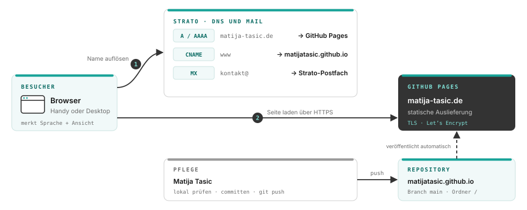
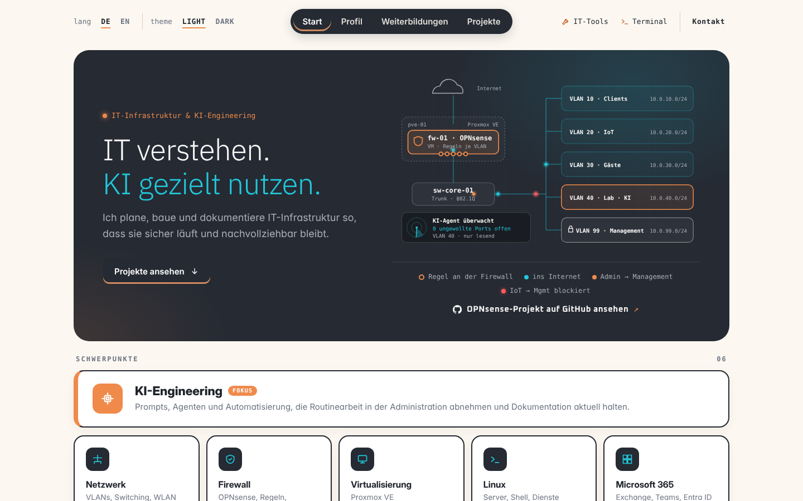
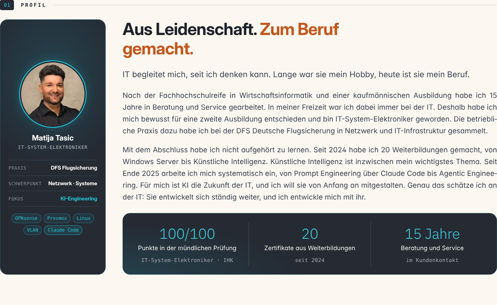
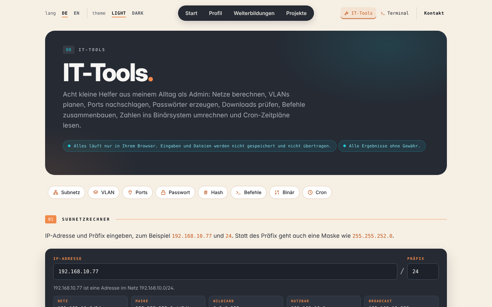
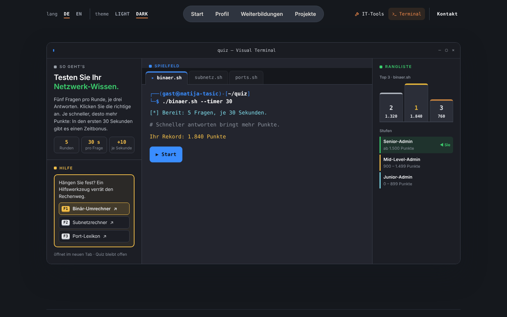
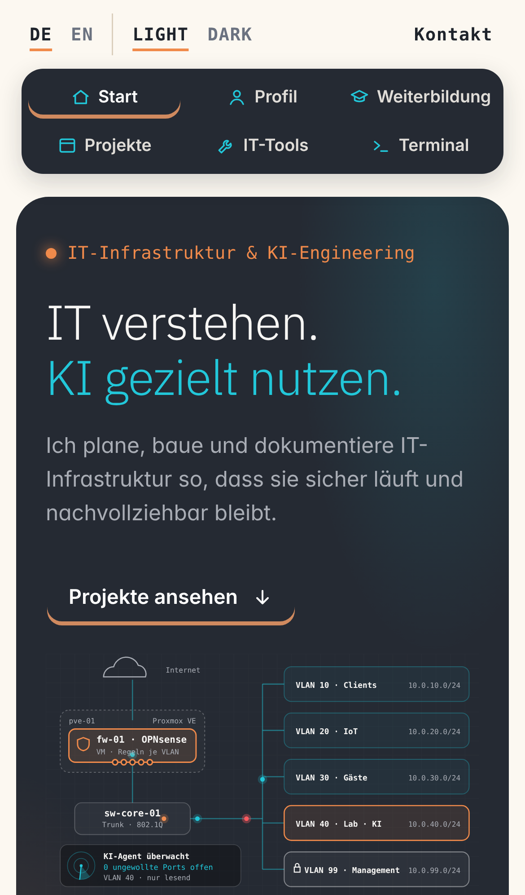
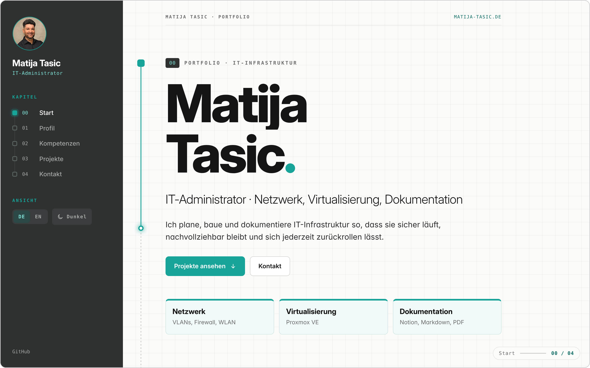
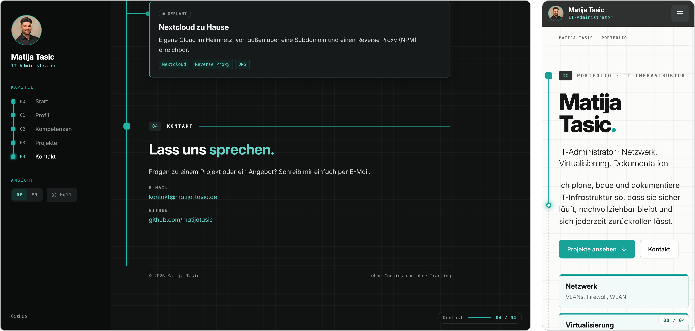
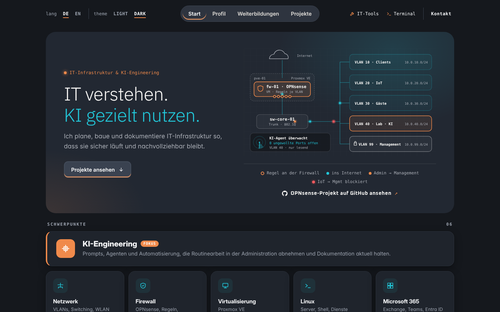

# Persönliche Homepage auf GitHub Pages

**Projektdokumentation** · Umsetzung: Matija Tasic · Erstveröffentlichung: 16.10.2026 · Stand: 04.11.2026

Eigene Homepage unter `matija-tasic.de`: statisch gebaut, bei GitHub Pages gehostet und über die Domain bei Strato erreichbar.

**Live:** [matija-tasic.de](https://matija-tasic.de) · **PDF (Stand 04.11.2026, PR #106):** [Abschlussdokumentation_Homepage.pdf](Abschlussdokumentation_Homepage.pdf) · **Erste Fassung (16.10.2026):** [Abschlussdokumentation_Homepage_2026-10-16.pdf](Abschlussdokumentation_Homepage_2026-10-16.pdf) · **Quellcode der Seite:** [matijatasic.github.io](https://github.com/matijatasic/matijatasic.github.io)

> **Hinweis:** Diese README und das PDF beschreiben den Stand vom 04.11.2026 bis einschließlich PR #106 der Seite. Das PDF ist eine Druckfassung dieser README. Die erste Fassung vom 16.10.2026 bleibt als eigenes PDF erhalten. Alle Änderungen seit der ersten Version stehen in [Kapitel 16](#16-weiterentwicklung-seit-der-ersten-version).

## 1. Zusammenfassung

Die persönliche Homepage ist als statische Seite mit HTML, CSS und JavaScript umgesetzt und läuft über GitHub Pages unter der eigenen Domain `matija-tasic.de`. Sie dient als Bewerbungsportfolio: Sie stellt Matija und seine Projekte potenziellen Arbeitgebern vor. Ein Gewerbe besteht nicht.

Die erste Version vom 16.10.2026 („Dossier“ mit dunkler Seitenleiste) wurde bis zum 04.11.2026 in 106 Pull Requests weiterentwickelt. Heute hat die Seite eine Kopfleiste statt der Seitenleiste, das Layout „Netzplan“ in drei Farben (Schiefer, Kupfer, Türkis) auf cremefarbenem Grund, eigene Seiten für IT-Tools und ein Terminal-Quiz sowie Impressum, Datenschutzerklärung und Kontaktformular. Die Domain wurde zu Beginn bei Strato aufgeräumt: alte Subdomains und DynDNS entfernt, die Einträge auf GitHub gesetzt und eine Kontaktadresse eingerichtet.

**Ergebnis:**

- Homepage live unter `matija-tasic.de`, veröffentlicht automatisch bei jedem Push auf `main`
- Startseite mit Slogan „IT verstehen. KI gezielt nutzen.“, Netzplan-Grafik, Schwerpunkten, Profil, Weiterbildungen, Projekten und Kontakt
- Seite „IT-Tools“ mit acht Werkzeugen und Seite „Terminal“ mit drei Quiz-Modi, Hilfe und lokaler Rangliste
- Impressum, Datenschutzerklärung und Kontaktformular (öffnet das E-Mail-Programm, kein Formular-Dienst)
- Deutsch und Englisch per Schalter, helle und dunkle Darstellung, für Handy und Desktop
- Suchmaschinen-Grundlagen: Canonical, Vorschaubild, strukturierte Daten, Sitemap, Search Console bestätigt
- Verschlüsselt über HTTPS mit Zertifikat von Let’s Encrypt, http wird automatisch umgeleitet
- Keine Cookies, kein Tracking, keine externen Schriften oder Dienste
- DNS bei Strato sauber auf GitHub umgestellt, alte Einträge und DynDNS entfernt
- Kontakt über `kontakt@matija-tasic.de`, Zustellung getestet
- Alle Commits nur mit Matija Tasic als Autor

## 2. Ausgangslage und Ziel

**Ausgangslage**

- Domain `matija-tasic.de` bei Strato in einem einfachen Domain-Paket
- Hauptdomain zeigte per DynDNS auf den Internetanschluss zu Hause
- Drei alte Subdomains aus früheren Heimserver-Projekten, keine davon mehr in Betrieb
- Kein eigener Webauftritt vorhanden

**Ziel**

- Eigene Homepage als Portfolio, gehostet auf GitHub Pages
- Hauptdomain zeigt auf GitHub, Subdomains bleiben für spätere Heimserver-Projekte frei
- Gestaltung angelehnt an Bewerbung und Dokumentation, seriös, mit eigenem Wiedererkennungswert
- Zuerst steht die Seite, die Inhalte folgen später

### 2.1 Umfang

**Im Umfang**

- Aufbau der Seite in HTML und CSS
- Sprach- und Darstellungsschalter
- Repository und Veröffentlichung mit GitHub Pages
- Domain, DNS und HTTPS
- Kontaktadresse bei Strato

**Außerhalb des Umfangs**

- Endgültige Texte und Projektinhalte
- Nextcloud und Reverse Proxy zu Hause (eigenes Projekt)
- Analyse- oder Tracking-Werkzeuge

## 3. Anforderungen

Die Anforderungen wurden zu Beginn gemeinsam erhoben. Es wurde nichts ergänzt, was nicht ausdrücklich gewünscht war.

| Anforderung | Umsetzung |
|---|---|
| Hauptdomain `matija-tasic.de` auf GitHub | GitHub Pages mit eigener Domain, Einträge bei Strato |
| Subdomains später für den Heimserver | Nur Hauptdomain und `www` belegt, alles andere frei |
| Portfolio im Stil von Bewerbung und Doku | Erst Konzept „Dossier“ (Seitenleiste, Petrol), seit 03.11.2026 „Netzplan“ mit Kopfleiste und drei Farben |
| Abheben von üblichen IT-Seiten, seriös, mit Aha-Effekt | Scroll-gesteuerte „Leitung“, die Kapitel wie Netzwerk-Ports verbindet |
| Reines HTML/CSS | Kein Framework, kein Build-Schritt |
| Repository `matijatasic.github.io` | Öffentliches Repository, Veröffentlichung aus `main` |
| Deutsch mit Schalter auf Englisch | Alle Texte doppelt gepflegt, Wahl wird gemerkt |
| Hell/Dunkel-Schalter | Seite startet hell, Wahl gilt für den laufenden Besuch (erste Version: folgte der Systemeinstellung) |
| Kontaktmöglichkeit | E-Mail-Adresse und Kontaktformular im Kapitel Kontakt (seit 18.10.2026) |
| Bewerbungsportfolio für Arbeitgeber (18.10.2026) | Profil, Weiterbildungen und Projekte stehen vorn im Menü, Extras wie IT-Tools und Terminal sind abgesetzt |
| Impressum und Datenschutzerklärung (18.10.2026) | Eigene Seiten, Impressum und Datenschutz mit `noindex` |

## 4. Architektur

| Baustein | Aufgabe |
|---|---|
| Strato | Registrar und DNS der Domain, Postfach für E-Mails |
| GitHub Repository | Quellcode der Seite, jeder Push auf `main` löst die Veröffentlichung aus |
| GitHub Pages | Ausliefern der Seite, TLS-Zertifikat für die eigene Domain |
| Browser | Sprache wird gemerkt (localStorage), die Darstellung nur für den laufenden Besuch (sessionStorage), die Quiz-Bestenliste lokal (localStorage) |

## 5. Gestaltung und Aufbau der Seite

### 5.1 Aktuelles Konzept „Netzplan“ (seit 03.11.2026)

Aus rund 46 Entwürfen hat Matija am 03.11.2026 den Entwurf 38 gewählt. Es gibt nur drei Farben: **Schiefer** als Grundton, **Kupfer** für Wichtiges und KI, **Türkis** für Netzwerk. Der Hintergrund ist ein helles Creme, etwa die Hälfte der Fläche ist hell. Die Seite startet hell, die Terminal-Seite ist immer dunkel.

| Bereich | Inhalt |
|---|---|
| Kopfleiste | Links die Schalter im Terminal-Stil `lang DE EN` und `theme LIGHT DARK`, in der Mitte eine dunkle Kapsel mit Start, Profil, Weiterbildungen, Projekte, rechts IT-Tools und Terminal als dezente Links, dann „Kontakt“. Auf dem Handy ein Raster mit allen Seiten statt Menü-Knopf |
| Start | Slogan „IT verstehen. KI gezielt nutzen.“ in IBM Plex Sans, kurzer Text, Button „Projekte ansehen“. Daneben der Netzplan: Internet, OPNsense als VM auf Proxmox, Core-Switch, VLAN 10 bis 40 und Management-VLAN 99, wandernde Datenpakete (ein geblocktes Paket IoT → Management in Rot), Fenster „KI-Agent überwacht“, Legende und Link zum OPNsense-Projekt auf GitHub |
| Schwerpunkte | KI-Engineering hervorgehoben, dazu Netzwerk, Firewall, Virtualisierung, Linux, Microsoft 365 |
| 01 Profil | Dunkle Fotokarte „IT-System-Elektroniker“ mit Steckbrief und Werkzeug-Chips, Text „Aus Leidenschaft. Zum Beruf gemacht.“, darunter ein Kennzahlen-Band: 100/100 Punkte in der mündlichen Prüfung, 20 Zertifikate (verlinkt auf die Weiterbildungen), 15 Jahre Beratung und Service |
| 02 Weiterbildungen | Ein großes Fenster `~/weiterbildungen` mit 20 Kursen seit 2024 in sechs Themenfeldern |
| 03 Projekte | Karten im Fenster-Stil: Proxmox Backup Server, Netzsegmentierung mit OPNsense, diese Homepage, Nextcloud (geplant) |
| 04 Kontakt | Kontaktformular mit Linien-Feldern und E-Mail-Adresse |

**Weitere Seiten**

| Seite | Inhalt |
|---|---|
| `werkzeuge.html` (IT-Tools) | Subnetzrechner, VLAN-Planer, Port-Lexikon (Well-known-Ports bis 1023), Passwortgenerator, Hash-Rechner, Befehls-Baukasten (30 Linux-Vorlagen), Binär-Umrechner, Cron-Erklärer (Klartext und nächste Ausführungen). Alles läuft nur im Browser |
| `terminal.html` (Terminal) | Quiz im Kali-Stil mit den Modi Binär, Subnetz und Ports, in drei Spalten: links „So geht’s“ und „Hilfe“ (Cheatsheet mit F1–F3 zu den passenden IT-Tools), in der Mitte das Spielfeld, rechts die Rangliste (Top 3 und Stufen Junior/Mid-Level/Senior). Fünf Fragen pro Runde, je drei Antworten, Zeitbonus in den ersten 30 Sekunden; danach wartet die Frage, bis eine Antwort gewählt ist |
| `impressum.html`, `datenschutz.html` | Rechtstexte, für Suchmaschinen ausgeblendet |
| `404.html` | Eigene Fehlerseite |

*Abb. 6 · Startseite auf dem Handy.*

### 5.2 Technik

| Datei | Inhalt |
|---|---|
| `index.html` | Startseite mit allen Kapiteln, Texte auf Deutsch und Englisch |
| `werkzeuge.html`, `terminal.html` | IT-Tools und Terminal-Quiz |
| `impressum.html`, `datenschutz.html`, `404.html` | Rechtstexte und Fehlerseite |
| `assets/css/site.css` | Gestaltung, Farbwerte für hell und dunkel, Handy-Ansicht |
| `assets/js/site.js` | Sprach- und Darstellungsschalter, Kopfleiste, Formular |
| `assets/js/quiz.js` | Terminal-Quiz |
| `assets/js/ipcalc.js`, `ports.js`, `pwgen.js`, `hash.js`, `cmds.js`, `binconv.js`, `cron.js`, `tools.js` | Logik und Oberfläche der IT-Tools |
| `assets/js/config.js` | Formular-Einstellung (`formEndpoint` bleibt leer, das Formular öffnet das E-Mail-Programm) |
| `tests/*.test.js` | Acht Testdateien für die Rechenlogik, laufen mit Node ohne Abhängigkeiten |
| `assets/fonts/` | Inter, IBM Plex Sans, DejaVu Sans Mono und Oxanium als WOFF2 mit Lizenztexten |
| `assets/img/` | Portrait, Favicon, Vorschaubild für soziale Netze |
| `robots.txt`, `sitemap.xml` | Hinweise für Suchmaschinen |
| `CNAME` | Eigene Domain für GitHub Pages |
| `.nojekyll` | Seite wird unverändert ausgeliefert, ohne Jekyll |

**Sprache:** Jeder Text steht doppelt im HTML, einmal mit `data-l="de"` und einmal mit `data-l="en"`. Der Schalter setzt nur die Sprache der Seite, das CSS blendet die jeweils andere Fassung aus. Ein kurzes Skript im Kopf der Seite stellt die gemerkte Wahl schon vor dem ersten Zeichnen her, damit nichts flackert.

**Darstellung:** Die Seite startet hell, auch auf dem Handy. Eine Wahl gilt nur für den laufenden Besuch. Auf dem Handy startet die Seite immer auf Deutsch. Die Terminal-Seite ist immer dunkel und setzt die Wahl beim Verlassen zurück.

**Cache-Buster:** `site.css`, `site.js`, `quiz.js` und `tools.js` werden mit `?v=JJJJMMTTnn` eingebunden. Bei jeder Änderung an CSS oder JS wird die Nummer in allen HTML-Dateien hochgezählt, damit Browser keine alte Fassung zeigen.

**Datenschutz by Design:** Keine Cookies, kein Tracking, keine Schriften oder Skripte von fremden Servern. Im Browser werden nur Sprache, Darstellung und die Quiz-Bestenliste gespeichert.

### 5.3 Erste Version „Dossier“ (16.10.2026)

Die erste Version las sich wie ein technisches Dossier: links eine dunkle Seitenleiste mit Portrait, Kapitelübersicht und Schaltern, Petrol `#17a398` als Akzent und eine „Leitung“, die beim Scrollen die Kapitel wie Ports in einem Netzplan verband. Kapitel waren 00 Start, 01 Profil, 02 Kompetenzen, 03 Projekte, 04 Kontakt.

## 6. Veröffentlichung auf GitHub Pages

| Einstellung | Wert |
|---|---|
| Repository | `matijatasic/matijatasic.github.io`, öffentlich |
| Quelle | Bereitstellung von einem Branch: `main`, Ordner `/` |
| Eigene Domain | `matija-tasic.de` |
| Domain-Verifizierung | TXT-Eintrag im GitHub-Profil bestätigt |
| HTTPS erzwingen | aktiviert, Zertifikat von Let’s Encrypt ausgestellt |

> **Ablauf (seit 16.10.2026):** Jede Änderung entsteht in einem eigenen Branch mit Pull Request. Zuvor gibt es meist mehrere Varianten als Vorschaubilder für PC und Handy, Matija wählt eine aus. Nach der Umsetzung folgen Vorher/Nachher-Bilder, gemergt wird erst nach Matijas OK (Rebase-Merge, Autor bleibt Matija). GitHub veröffentlicht die Seite danach selbst, in der Regel innerhalb einer Minute.

**Commits:** Alle Commits stehen nur unter dem Namen Matija Tasic und nutzen die private noreply-Adresse von GitHub. So bleibt die echte E-Mail-Adresse verborgen.

## 7. Domain und DNS bei Strato

### 7.1 Vorgehen

Die Reihenfolge folgt der Empfehlung von GitHub, damit niemand anderes die Domain bei GitHub Pages übernehmen kann:

1. Domain im GitHub-Profil verifizieren (TXT-Eintrag)
2. Eigene Domain im Repository eintragen
3. DNS-Einträge bei Strato auf GitHub umstellen
4. Zertifikat abwarten, HTTPS erzwingen

### 7.2 Vorher und nachher

| Eintrag | Vorher | Nachher |
|---|---|---|
| Hauptdomain A | Heimanschluss über DynDNS | `185.199.108.153` (GitHub Pages) |
| Hauptdomain AAAA | keiner | `2606:50c0:8000::153` (GitHub Pages) |
| TXT `_github-pages-challenge-matijatasic` | keiner | Prüfwert von GitHub |
| `www` | Strato-Platzhalter | CNAME auf `matijatasic.github.io` |
| DynDNS | aktiv, aktualisiert von der FRITZ!Box | bei Strato und in der FRITZ!Box abgeschaltet |
| Alte Subdomains (3) | vorhanden, ohne Funktion | gelöscht |
| E-Mail (MX) | Strato | unverändert Strato |

> **Wichtig bei Strato:** Ein CNAME auf der Hauptdomain hätte alle übrigen Einträge abgeschaltet, auch die E-Mail. Der CNAME für `www` wurde deshalb in der Subdomain selbst gesetzt. Neben dem Eingabefeld muss `.www.matija-tasic.de` stehen, nicht `.matija-tasic.de`.

### 7.3 DynDNS abschalten

Strato erlaubt einen eigenen A-Eintrag nur ohne DynDNS. DynDNS wurde deshalb zuerst bei Strato und danach in der FRITZ!Box abgeschaltet (Internet → Freigaben → DynDNS). Sonst hätte die FRITZ!Box den Eintrag für GitHub später wieder mit der Heim-IP überschrieben. Portfreigaben für 80 oder 443 gab es in der FRITZ!Box keine.

Für den Zugriff auf die FRITZ!Box aus dem privaten Netz kam in OPNsense eine eng gefasste Regel dazu: nur die Admin-PCs, nur zur FRITZ!Box, nur HTTPS. Sie steht über der Sperrregel für interne Netze und folgt dem Namensschema aus dem Segmentierungsprojekt.

## 8. HTTPS

GitHub Pages stellt für die eigene Domain automatisch ein Zertifikat von Let’s Encrypt aus. Das gelingt erst, wenn alle zugehörigen Namen korrekt auf GitHub zeigen. Solange `www` noch auf den Strato-Platzhalter zeigte, blieb die Ausstellung hängen.

> **Stand 16.10.2026, 20:19:** Nachdem `www` per CNAME auf GitHub zeigte, hat GitHub das Zertifikat ausgestellt. Die Seite lädt mit Schloss, und „HTTPS erzwingen“ leitet jeden Aufruf über http automatisch auf https um.

## 9. E-Mail

Die Adresse `kontakt@matija-tasic.de` ist bei Strato als Alias auf ein bestehendes Postfach eingerichtet. Mails an die Adresse landen dort und sind per Webmail oder IMAP abrufbar. Eine Testmail von einer externen Adresse ist angekommen.

Seit dem 18.10.2026 gibt es wieder ein Kontaktformular. Es öffnet beim Absenden das E-Mail-Programm des Besuchers mit vorausgefüllter Nachricht (`mailto`). Bewusst wird kein Formular-Dienst genutzt: kein Konto, kein Tarif, keine fremden Server.

**Auftragsverarbeitung:** Mit STRATO besteht ein Vertrag zur Auftragsverarbeitung nach Art. 28 DSGVO. Er wurde am 26.04.2026 abgeschlossen und am 04.11.2026 auf die aktuelle Version gebracht (Kunden-Login → Ihre Kundendaten → Auftragsverarbeitung). Laut STRATO werden die Daten nur in den Rechenzentren Berlin und Karlsruhe verarbeitet. Die Datenschutzerklärung nennt STRATO seit dem 04.11.2026 als E-Mail-Anbieter.

## 10. Tests

| Test | Ergebnis |
|---|---|
| Veröffentlichung durch GitHub Pages (5 Durchläufe) | ok |
| Domain-Verifizierung per TXT | ok |
| DNS-Prüfung in den Pages-Einstellungen | ok, „DNS-Prüfung erfolgreich“ |
| Aufruf über `matija-tasic.de` | ok |
| Testmail an `kontakt@matija-tasic.de` | ok, im Postfach angekommen |
| Schalter Deutsch / Englisch | ok, alle Texte wechseln, Wahl bleibt nach Neuladen |
| Schalter Hell / Dunkel | ok, Wahl bleibt nach Neuladen |
| Handy-Ansicht 390 px | ok, kein seitliches Scrollen, Menü funktioniert |
| Browser-Konsole | ok, keine Fehler |
| Zertifikat für HTTPS | ok, ausgestellt, http wird auf https umgeleitet |
| Aufruf über `www.matija-tasic.de` | ok, Zertifikat gilt auch für www |
| Unit-Tests der IT-Tools und des Quiz (8 Testdateien, 04.11.2026, Stand PR #106) | ok |
| Terminal: Zeitablauf mit simulierter Uhr, Frage wartet auf Antwort (04.11.2026) | ok |
| Jede Änderung seit 18.10.2026: Vorher/Nachher-Bilder für PC, Handy, hell, dunkel, Englisch | ok, vor jedem Merge von Matija geprüft |
| Google Search Console: Bestätigung und Sitemap (21.10.2026) | ok |
| Auftragsverarbeitungsvertrag mit STRATO, aktuelle Version (04.11.2026) | ok, abgeschlossen |

## 11. Entscheidungen

| Datum | Entscheidung | Begründung |
|---|---|---|
| 16.10.2026 | Hauptdomain auf GitHub, Subdomains frei | Homepage zuerst, Heimserver-Dienste später über Subdomains |
| 16.10.2026 | Reines HTML/CSS ohne Framework | Wenig Abhängigkeiten, leicht zu pflegen, schnell |
| 16.10.2026 | Konzept „Dossier“ | Passt zu Bewerbung und Doku, hebt sich von üblichen IT-Seiten ab |
| 16.10.2026 | Schriften lokal statt von Google Fonts | Keine Verbindung zu fremden Servern beim Seitenaufruf |
| 16.10.2026 | Alte Subdomains gelöscht | Ohne Funktion, später bei Bedarf neu anlegen |
| 16.10.2026 | DynDNS abgeschaltet | Nötig für eigenen A-Eintrag, zu Hause läuft derzeit nichts darüber |
| 16.10.2026 | Kein Kontaktformular | Kontakt per E-Mail reicht, kein externer Formular-Dienst nötig |
| 16.10.2026 | Kein Impressum und keine Datenschutzerklärung | Bewusste Entscheidung des Betreibers, Seiten bei Bedarf aus der Git-Historie wiederherstellbar |
| 16.10.2026 | Automatische Browser-Übersetzung abgeschaltet | Die Seite hat einen eigenen Sprachschalter |
| 18.10.2026 | Impressum, Datenschutzerklärung und Kontaktformular wiederhergestellt | Die Seite ist ein Bewerbungsportfolio für Arbeitgeber |
| 18.10.2026 | Formular ohne Dienst, öffnet das E-Mail-Programm | Kein Konto, kein Tarif, keine fremden Server |
| 20.10.2026 | Seite IT-Tools | Zeigt Praxiswissen zum Ausprobieren |
| 21.10.2026 | SEO-Grundlagen und Search Console | Bei der Suche nach dem Namen gefunden werden |
| 03.11.2026 | Neues Layout „Netzplan“ mit Kopfleiste, drei Farben | Moderner, klarer, Fokus auf KI-Engineering |
| 03.11.2026 | Terminal-Quiz als eigene Seite | Die Startseite bleibt auf Profil und Projekte fokussiert |
| 04.11.2026 | IT-Tools und Terminal rechts neben Kontakt abgesetzt | Arbeitgeber sollen zuerst Profil, Weiterbildungen und Projekte sehen |
| 04.11.2026 | Handy: Raster mit allen Seiten statt Menü-Knopf, Start hell und auf Deutsch | Alle Seiten mit einem Tipp erreichbar, gleicher erster Eindruck wie am PC |
| 04.11.2026 | Firewall-Zonen-Matrix wieder entfernt, dafür Cron-Erklärer | Für Besucher zu unübersichtlich, besonders auf dem Handy |
| 04.11.2026 | Terminal in drei Spalten, Frage wartet nach Zeitablauf | Spielfeld, Hilfe und Rangliste klar getrennt; niemand verpasst eine Frage |

## 12. Probleme und Lösungen

**Eigener A-Eintrag bei Strato nicht möglich**

- *Ursache:* DynDNS war für die Hauptdomain aktiv.
- *Lösung:* DynDNS bei Strato abgeschaltet, danach A- und AAAA-Eintrag gesetzt.

**FRITZ!Box aus dem privaten Netz nicht erreichbar**

- *Ursache:* Die Firewall sperrt bewusst alle internen Netze, also auch das Netz der FRITZ!Box.
- *Lösung:* Eng gefasste Regel nur für die Admin-PCs und nur HTTPS, oberhalb der Sperrregel.

**Neue Firewall-Regel griff nicht**

- *Ursache:* Der Alias für die FRITZ!Box war gespeichert, aber noch nicht angewendet und damit leer.
- *Lösung:* Auf der Alias-Seite „Anwenden“ geklickt, Inhalt unter Firewall → Diagnose → Aliase geprüft.

**Englische Fassung erschien auf Deutsch**

- *Ursache:* Der Browser übersetzte die englische Seite automatisch zurück ins Deutsche.
- *Lösung:* Seite als nicht zu übersetzen markiert (`translate="no"`), der eigene Schalter genügt.

**CNAME beinahe auf der Hauptdomain**

- *Ursache:* Das CNAME-Formular der Hauptdomain sieht dem der Subdomain sehr ähnlich.
- *Lösung:* Vor dem Speichern abgebrochen, CNAME in der Subdomain `www` gesetzt. Merkmal ist die Endung neben dem Eingabefeld.

**HTTPS-Zertifikat wurde nicht ausgestellt**

- *Ursache:* `www` zeigte noch auf den Strato-Platzhalter.
- *Lösung:* CNAME für `www` auf `matijatasic.github.io`, danach hat GitHub die Ausstellung neu gestartet.

## 13. Lessons Learned

- Die von GitHub empfohlene Reihenfolge (erst verifizieren, dann umstellen) verhindert, dass jemand anderes die Domain übernimmt.
- Vor einer DNS-Änderung immer den Ist-Stand per Screenshot sichern.
- Bei Strato hängt viel an der richtigen Ebene: Hauptdomain und Subdomain haben eigene DNS-Seiten.
- Eine strenge Firewall wirkt auch gegen den eigenen Router. Ausnahmen so eng wie möglich halten.
- In OPNsense werden Aliase erst mit „Anwenden“ aktiv. Die Diagnose-Seite zeigt den echten Inhalt.
- Zweisprachige Seiten sollten die automatische Browser-Übersetzung abschalten.
- Ohne Cache-Buster zeigen Browser nach einer Änderung oft noch die alte CSS- oder JS-Datei.
- Mehrere Varianten als Bilder nebeneinander führen schneller zu einer Entscheidung als Beschreibungen.
- Ein Bild immer im Original sichern, bevor es bearbeitet wird.

## 14. Offene Punkte

Erledigt am 04.11.2026: Datenschutzerklärung um die Quiz-Bestenliste ergänzt (PR #78), PDF auf den aktuellen Stand gebracht. Noch offen:

1. Optional: die drei weiteren A- und AAAA-Adressen von GitHub Pages ergänzen, für mehr Ausfallsicherheit.
2. Späteres Heimserver-Projekt: DynDNS auf einer Subdomain statt auf der Hauptdomain.

## 15. Anhang

### 15.1 Chronologie

| Zeit | Meilenstein |
|---|---|
| 16:46 | Projekt in Notion angelegt; Anforderungen erhoben |
| 17:35 | Repository angelegt; erster Entwurf mit Vorschaubildern |
| 17:38 | Entwurf freigegeben; erste Version veröffentlicht |
| 17:52 | Ist-Stand bei Strato gesichert; alte Subdomains gelöscht |
| 18:09 | Domain verifiziert; eigene Domain im Repository eingetragen |
| ca. 18:30 | DynDNS bei Strato aus; A- und AAAA-Eintrag gesetzt; DNS-Prüfung erfolgreich |
| 18:50 | Zugriff auf die FRITZ!Box eingerichtet; DynDNS in der FRITZ!Box aus |
| 19:10 | Kontaktadresse eingerichtet; Testmail angekommen |
| 19:24 | Kontaktformular, Impressum und Datenschutz entfernt |
| 19:29 | Browser-Übersetzung abgeschaltet; Sprachschalter bestätigt |
| 19:53 | `www` per CNAME auf GitHub; Zertifikat neu angefordert |
| 20:19 | Zertifikat ausgestellt; HTTPS aktiv und erzwungen |

### 15.2 Projektverwaltung

Das Projekt wurde wie das Segmentierungsprojekt in Notion geführt: Projektseite, Aufgabendatenbank „Aufgaben Homepage“ mit Phasen von Bedarf bis Abschluss und ein Projektjournal. Jede Änderung an DNS und Firewall wurde vorher mit Risiko und Rückweg benannt und erst nach Freigabe umgesetzt.

## 16. Weiterentwicklung seit der ersten Version

Alle Änderungen liefen über Pull Requests im Repository der Seite. Die Nummern verweisen auf die PRs in [matijatasic.github.io](https://github.com/matijatasic/matijatasic.github.io/pulls?q=is%3Apr+is%3Amerged).

| Datum | PRs | Änderung |
|---|---|---|
| 16.10.2026 | #1–#7 | Seitenleiste symmetrisch, Projekt-Links als Schaltflächen, Karten hellgrün, Dunkelmodus anthrazit |
| 18.10.2026 | #8–#13 | Impressum, Datenschutzerklärung und Kontaktformular wiederhergestellt, Kontakttext auf Arbeitgeber ausgerichtet, Projekte angepasst |
| 20.10.2026 | #14–#24 | Seite IT-Tools mit Subnetzrechner, VLAN-Planer, Port-Lexikon, Passwortgenerator, Hash-Rechner; Kapitel Kompetenzen entfernt; Rubrik Tipps & Tricks (später wieder entfernt) |
| 21.10.2026 | #25–#43 | Befehls-Baukasten (nur Linux), SEO und Search Console, Startseite mit sechs Kacheln, Mini-Terminal mit Subnetz-, Port- und Binär-Quiz |
| 03.11.2026 | #44 | Neues Layout „Netzplan“ für die ganze Seite, Kopfleiste statt Seitenleiste, Start hell |
| 03.11.2026 | #45–#56 | Binär-Umrechner, IT-Tools als dunkle Werkbank-Karten, Creme-Hintergrund, Projekt-Karten als Fenster, Kopfleiste als Schiefer-Insel, Schriftzug und Monogramm in Oxanium, Kontaktformular mit Linien-Feldern |
| 03.11.2026 | #57–#61, #66 | Terminal-Quiz im Kali-Stil mit Zeitbonus, Bestenliste und Stufen, Explorer mit Cheatstore, eigene Seite `terminal.html`, immer dunkel |
| 03.11.2026 | #62–#69, #72–#74 | Profil neu: Text, Fotokarte links, Prüfungsergebnis 100/100 mündlich und 92/100 schriftlich, Blocksatz, bearbeitetes Profilbild |
| 03.11.2026 | #70–#71 | Abschnitt Weiterbildungen als großes Fenster mit Menüpunkt |
| 03.11.2026 | #75 | Slogan „IT verstehen. KI gezielt nutzen.“, dezentere Überschrift, Kontakt-Button in Kupfer |
| 04.11.2026 | #76 | Fotokarte im Profil mit Steckbrief und Werkzeug-Chips |
| 04.11.2026 | #77 | MT aus der Kopfleiste entfernt, IT-Tools und Terminal neben Kontakt abgesetzt |
| 04.11.2026 | #78 | Datenschutz: Quiz-Bestenliste und STRATO als E-Mail-Anbieter; Hinweise bei den IT-Tools |
| 04.11.2026 | #79–#82 | Fotokarte „IT-System-Elektroniker“, grüner Schriftzug ohne Namen; VLAN-Skizze kurz vereinfacht und wieder zurückgerollt |
| 04.11.2026 | #83, #88–#90 | Schalter im Terminal-Stil (`lang`, `theme LIGHT DARK`), dezente Buttons in Schiefer mit Kupferkante, Kopfleiste neutral, Slogan in IBM Plex Sans |
| 04.11.2026 | #84–#86, #93 | Handy: Raster mit allen Seiten, startet hell und auf Deutsch |
| 04.11.2026 | #87, #91–#92 | Profil: 100 von 100 Punkten, Kennzahlen-Band, „20 Zertifikate“ verlinkt |
| 04.11.2026 | #94–#99 | Netzplan fachlich korrigiert: Management-VLAN, wandernde Datenpakete, geblockter Fluss IoT → Management, Legende, KI-Agent-Fenster, Link zum OPNsense-Projekt |
| 04.11.2026 | #100–#101 | Firewall-Zonen-Matrix kurz online, wieder entfernt; neues IT-Tool Cron-Erklärer |
| 04.11.2026 | #102–#106 | Terminal: Cheatsheet als Hilfe, Rangliste, kompaktere Regeln, Anordnung in drei Spalten, Frage wartet nach Zeitablauf |

